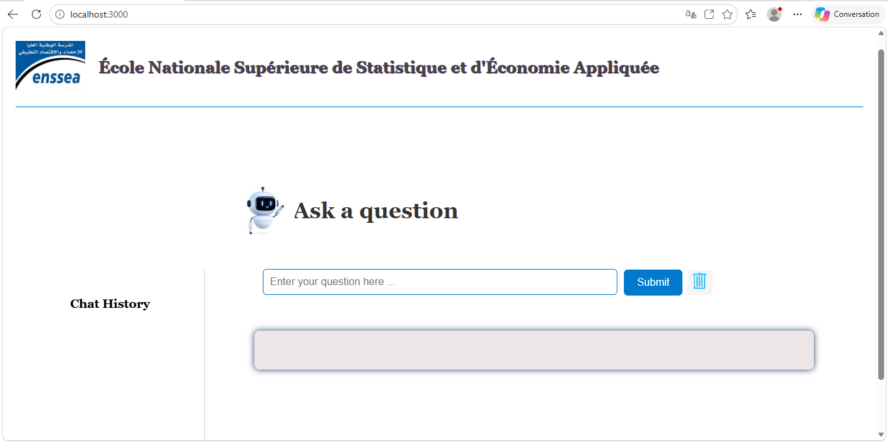
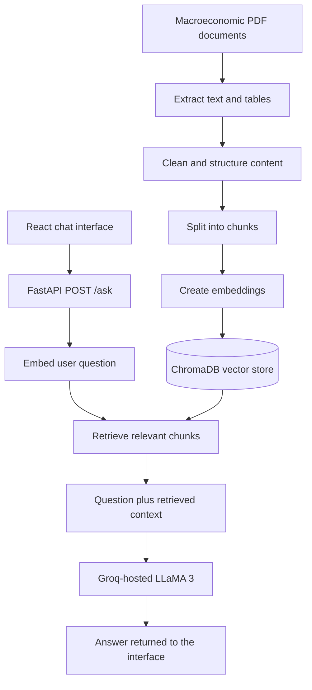

# RAG-Based Economic Chatbot for Analyzing Macroeconomic Indicators

An academic prototype of a web chatbot for asking questions about macroeconomic indicators. The system retrieves passages from an indexed collection of economic documents and supplies them to a large language model (LLM) to generate a contextual answer.

> **Project status:** the source code and local data stores were recovered, but the repository still needs configuration cleanup before another person can run it. See [Known setup work](#known-setup-work) before trying the commands below.

## Project goals

- Make macroeconomic information easier to explore through natural-language questions.
- Retrieve relevant passages from economic books and reports using a vector database.
- Process both prose and statistical tables from PDF documents.
- Compare two document-indexing approaches, including a table-aware pipeline.

## Interface preview



## Architecture



## Technology

- **Frontend:** React
- **Backend API:** Python and FastAPI
- **RAG orchestration:** LangChain
- **Embeddings:** HuggingFace `sentence-transformers/all-MiniLM-L6-v2`
- **Vector store:** ChromaDB
- **Answer generation:** Groq-hosted LLaMA 3
- **PDF processing:** PyPDFLoader and pdfplumber

## Recommended repository layout

```text
economic-rag-chatbot/
├── README.md
├── .gitignore
├── .env.example
├── backend/
│   ├── main.py
│   ├── llm.py
│   ├── connect.py
│   ├── embedding.py
│   └── requirements.txt
├── frontend/
│   ├── package.json
│   ├── package-lock.json
│   ├── public/
│   └── src/
├── scripts/
│   ├── indexation.py
│   ├── indexation2.py
│   └── experiments/
└── docs/
    └── architecture.png
```

The layout above is the proposed cleaned structure. Move only the indexing scripts that you have confirmed are useful into `scripts/`; keep experimental scripts separate from the application entry points.

## Request flow

1. Documents are loaded and their text and tables are extracted.
2. Extracted content is cleaned, split into chunks, and converted into embeddings.
3. Embeddings and chunk metadata are stored in ChromaDB.
4. The React frontend sends a question to the FastAPI endpoint.
5. The backend retrieves relevant chunks and passes them with the question to the LLM.
6. The generated answer is returned to the frontend.

## Local development

The frontend calls `http://localhost:8001/ask` and is intended to run at `http://localhost:3000`.

### Backend

Before starting the backend, complete the configuration items under [Known setup work](#known-setup-work), then install the Python dependencies listed in `backend/requirements.txt` (to be added after checking the imports and compatible package versions).

```bash
cd backend
uvicorn main:app --reload --port 8001
```

The endpoint accepts a JSON request such as:

```json
{
  "query": "How has inflation changed over time?"
}
```

### Frontend

```bash
cd frontend
npm install
npm start
```

Then open `http://localhost:3000`.

## Data and vector index

The thesis describes a document corpus made up of macroeconomic books and institutional economic reports. The source PDFs and the generated ChromaDB index are not included here by default. Obtain and use documents only when their terms permit it, and document the sources in a separate data note.

The local project currently contains more than one `chroma_store` directory. Configure the backend to use one explicit, consistent vector-store path. Do not commit the large local database to GitHub; document how to rebuild it or how to provide it locally instead.

## Evaluation

The thesis describes a qualitative comparison using 40 macroeconomic questions. Responses from the RAG chatbot and standalone language models were assessed with an LLM-as-a-Judge approach for relevance and accuracy. It also compares two RAG document-processing pipelines, with the second focusing on improved extraction and structuring of tables.

The reported evaluation is qualitative and depends on the selected questions, corpus, retrieval settings, and judge model. It should not be presented as proof that RAG always outperforms standalone LLMs.

## Known setup work

The recovered folder is not yet a portable, one-command installation. Before presenting it as reproducible:

- Remove API credentials from source files, revoke any credentials that were exposed, and load a replacement key from an ignored `.env` file.
- Add `.env.example` with variable names only, never real values.
- Add and verify a `backend/requirements.txt` with compatible dependency versions.
- Replace machine-specific absolute paths in indexing scripts with configurable paths relative to the project.
- Point the backend and indexing scripts to the same populated ChromaDB store.
- Verify that the chosen indexing script creates the same embedding format the backend uses for queries.
- Configure the frontend API URL for local and deployed environments.
- Replace the default Create React App README and update or remove the starter test that still expects “learn react”.
- Sanitize generated HTML before displaying model responses in the browser.

## What should not be committed

- `.env` files, API keys, tokens, and credentials
- `node_modules/`, Python virtual environments, `__pycache__/`, and `.pyc` files
- ChromaDB files and other generated indexes
- PDF books, reports, or extracted documents unless redistribution is explicitly permitted
- Temporary files and unused experimental scripts

## Academic context

This repository accompanies the academic project **“RAG-Based Economic Chatbot for Analyzing Macroeconomic Indicators”** (2024–2025), submitted at the National Graduate School of Statistics and Applied Economics (ENSSEA).

## License

Add a license only after confirming that you have the right to publish the code and that the license is compatible with the project dependencies and data sources.
